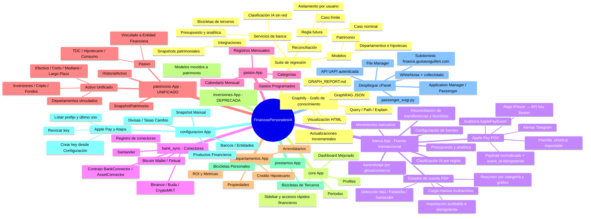

# 🤖 AI Agent Guide - FinanzasPersonalesIA

Proyecto de en desarrollo, el proyecto es para organizar las finanzas personales. Como esta en desarrollo los datos y la logica pueden cambiar. La idea es implementando caracteristicas poco a poco y los datos dentro de lo posible se mantengan relacionados si el ambito lo permite.

Proyecto hecho en Django.

Haz una bitacora de los cambios que hagas en el proyecto en el archivo AGENTS.md, ademas de los cambios que hagas en el codigo.

Genera un mapa mental del proyecto tambien en AGENTS.md, asi como sus cambios.

Y nunca olvidar actualizar README.md si aplica.

## 🔎 Uso de Graphify

Graphify es la herramienta de exploración del código y la documentación del proyecto. Está disponible mediante el skill `/graphify` y genera un grafo navegable con detección de comunidades, reporte auditable y salidas para consultas posteriores.

- **Construir el grafo completo**: `/graphify` (usa el directorio actual).
- **Actualizar incrementalmente**: `/graphify . --update` después de cambios en archivos existentes o nuevos.
- **Reconstruir con mayor profundidad**: `/graphify . --mode deep` cuando se necesiten más relaciones inferidas.
- **Consultar la arquitectura**: `/graphify query "¿Cómo fluye la información entre X e Y?"`.
- **Trazar una conexión**: `/graphify path "Concepto A" "Concepto B"`.
- **Explicar un nodo**: `/graphify explain "Nombre del nodo"`.

Los resultados se guardan en `graphify-out/`:

- `graph.html`: visualización interactiva.
- `graph.json`: grafo para GraphRAG y consultas automatizadas.
- `GRAPH_REPORT.md`: comunidades, nodos principales, conexiones sorprendentes y preguntas sugeridas.
- `manifest.json`: manifiesto utilizado por las actualizaciones incrementales.

Antes de reconstruir, usar las consultas sobre el grafo existente cuando `graphify-out/graph.json` esté disponible. La extracción estructural de código no requiere API keys; Gemini es opcional para enriquecer la extracción semántica de documentación, papers o imágenes. Los archivos generados son derivados y no deben editarse manualmente.

## ✅ Regla obligatoria para futuras funcionalidades

Toda funcionalidad nueva, modificación de lógica financiera o corrección de bug debe
incluir o actualizar tests automatizados antes de considerarse terminada.

- Cubrir como mínimo el caso nominal y un caso límite relevante.
- Cubrir aislamiento por usuario cuando la funcionalidad trabaje con datos de usuarios.
- Mantener las integraciones externas herméticas mediante mocks o datos sintéticos.
- Ejecutar `venv/bin/python manage.py test` y no cerrar el cambio con tests fallidos.
- Registrar en esta bitácora los cambios relevantes de cobertura y los bugs descubiertos
  por la suite.

---

## 📝 Bitácora de Cambios (Changelog)
+
+### [2026-03] Cardstats en Calendario & Ahorro Programado
+- **Métricas de Ahorro**: Implementación de un panel de Cardstats en `/dashboard/calendario/` para visualizar el esfuerzo de ahorro mensual necesario.
+- **Cálculo de Reserva**: Los Gastos Programados con frecuencia no mensual (Anual, Semestral, etc.) ahora muestran su cuota de ahorro mensual equivalente en un Card-stat unificado (`ahorro_mensual_total`).
+- **Quick Insights**:
+  - Se añadió un contador de Gastos Activos.
+  - Se implementó un detector de "Próximo Vencimiento" que prioriza el pago más cercano en el calendario del mes actual.
+- **Archivos actualizados**: `core/views.py`, `templates/calendario.html`.
+

### [2026-08-25] Sincronización de la versión local con cPanel
- **Despliegue**: Se subió el código local actualizado a `/home/gustzyif/finance_app` mediante la API de cPanel, incluyendo templates, migraciones, dependencias y estáticos recolectados.
- **Protección de producción**: Se conservaron el `.env`, `db.sqlite3` y `media/` existentes; los archivos temporales de subida y migración se retiraron al finalizar.
- **Base de datos**: Se ejecutó `migrate --noinput`; no había migraciones pendientes.
- **Validación**: La versión local pasó `manage.py check`, 103 tests automatizados y `git diff --check`; Passenger fue reiniciado tras la sincronización.

### [2026-08-25] Plantilla importable para el Atajo de Apple Pay
- **Distribución**: Se generó y firmó con la utilidad nativa de macOS una plantilla `.shortcut` que configura el POST a producción, headers, JSON, `event_id` basado en fecha/entrada y notificación local.
- **Seguridad**: El archivo no contiene una API key real; incluye una pregunta de importación y el marcador `PASTE_API_KEY_HERE` como respaldo.
- **Compatibilidad Shortcuts 7.0**: Se corrigió un crash de importación causado por serializar variables de texto como `WFTextTokenAttachment` y el monto como tipo numérico con estado textual. Los diccionarios HTTP ahora se validan contra WorkflowKit local antes de firmar.
- **Corrección Wallet v2**: Se comprobó localmente que el trigger entrega `Amount` como `INCurrencyAmount`; la plantilla ahora extrae `Amount → Currency Amount` y muestra la respuesta real de Django en vez de una confirmación incondicional.
- **Documentación**: `docs/APPLE_PAY_POC.md` explica la importación en Mac, la sincronización opcional con iCloud y la configuración final de la automatización en iPhone.
- **Archivo añadido**: `docs/shortcuts/FinanzasPersonalesIA - Registrar Apple Pay v2 - Importable.shortcut`.

### [2026-08-25] Gestión visual de keys Apple Pay en Configuración
- **Configuración**: Se añadió el panel **Apple Pay y Atajos** a `/dashboard/configuracion/` para crear keys con nombre, listar prefijo/último uso y revocarlas por usuario.
- **Seguridad**: El secreto completo se entrega una sola vez mediante la sesión y nunca se vuelve a consultar desde la base de datos, que conserva únicamente el hash.
- **Tests**: `core/tests.py` cubre creación, visualización única, límite de nombre, revocación y aislamiento entre usuarios.
- **Documentación**: Se actualizaron `README.md`, `API_DOCUMENTATION.md` y `docs/APPLE_PAY_POC.md` con el flujo visual.
- **Archivos actualizados**: `core/views.py`, `core/urls.py`, `templates/configuracion.html`, `core/tests.py`, `README.md`, `API_DOCUMENTATION.md`, `docs/APPLE_PAY_POC.md`.

### [2026-08-24] Preparación y despliegue cPanel/Passenger
- **Producción Django**: Se parametrizaron `SECRET_KEY`, `DEBUG`, hosts, CSRF, cookies seguras y `FORCE_SCRIPT_NAME` para soportar tanto subdominio raíz como montajes con prefijo.
- **Rutas**: Se corrigieron redirecciones y acciones JavaScript que asumían la raíz del dominio; ahora respetan el prefijo de Passenger.
- **Servidor**: Se añadió `passenger_wsgi.py`, carga opcional de `.env` sin credenciales cPanel y WhiteNoise para servir estáticos con `DEBUG=0`.
- **Validación**: Se añadió cobertura de redirección bajo `/finance`; la suite pasó 99 tests.
- **cPanel**: La API autenticada permite File Manager y Application Manager/Passenger. El sitio existente en `public_html` se conserva, se creó `finance.gustavoguillen.com` y la aplicación se mantiene en un directorio separado.
- **Resolución en hosting**: La creación de la Web Application desde Python Selector activó el enrutamiento; se instalaron las dependencias en el virtualenv de Python 3.13 y la aplicación quedó operativa en el subdominio.

### [2026-08-24] Corrección del destino de publicación
- **URL final**: Se corrigió el destino solicitado desde `gustavoguillen.com/finance` a `finance.gustavoguillen.com`.
- **Configuración Passenger**: La aplicación quedó asociada al subdominio con `base_uri=/`; las variables de entorno de producción se respaldan también en el `.env` privado del directorio de la aplicación para el caso en que el hosting no persista variables mediante la API.

### [2026-08-24] Corrección de arranque en Python Selector
- **Causa**: Python Selector generó un `passenger_wsgi.py` que se cargaba a sí mismo, provocando `RecursionError` y HTTP 500.
- **Solución**: Se separó el WSGI real en `finance_wsgi.py` y `passenger_wsgi.py` quedó como wrapper compatible con el selector.
- **Dependencias**: Se instaló `requirements.txt` en `/home/gustzyif/virtualenv/finance_app/3.13/`; la URL pública responde al login y los estáticos cargan correctamente.

### [2026-08-24] POC Apple Pay vía Atajo de iPhone
- **API segura**: Se añadieron `ApplePayApiKey` y el endpoint `POST /banca/api/apple-pay/ingest/`. La llave se muestra una sola vez, se almacena como hash, puede listarse y revocarse por usuario.
- **Flujo transaccional**: El endpoint valida un payload Apple Pay, resuelve el producto/TDC, crea `MovimientoBancario`, ejecuta reglas/IA de clasificación y reutiliza el aviso Telegram existente.
- **Idempotencia y auditoría**: `ApplePayEvent` conserva el hash del payload y evita duplicados por `user + event_id`; cambiar los datos de un evento existente devuelve conflicto `409`.
- **Herramientas**: Se añadió `generate_apple_pay_key` y la guía `docs/APPLE_PAY_POC.md` con el contrato JSON y pasos del Atajo. `README.md` y `API_DOCUMENTATION.md` documentan la POC.
- **Tests**: `banca/test_apple_pay.py` cubre creación, clasificación por regla e IA con aprendizaje, reintentos, conflicto, USD, límites, revocación y aislamiento entre usuarios.
- **Archivos actualizados**: `banca/models.py`, `banca/migrations/0008_applepayapikey_applepayevent.py`, `banca/services/apple_pay.py`, `banca/views.py`, `banca/urls.py`, `banca/admin.py`, `banca/management/commands/generate_apple_pay_key.py`, `banca/test_apple_pay.py`, `docs/APPLE_PAY_POC.md`, `README.md`, `API_DOCUMENTATION.md`.

### [2026-08] Menú lateral de accesos rápidos financieros
- **Navegación**: Se agregó al sidebar autenticado una sección de accesos rápidos para Santander, Scotiabank, Bci, Banco Falabella, Itaú, AFP Uno, AFC, CMF deudas, Fintual, DVA, SoyFocus y BTG Pactual.
- **UX/UI**: Cada acceso incluye icono Font Awesome, estado hover consistente con el tema, indicador de enlace externo y apertura segura en una pestaña nueva. El contenido principal del sidebar ahora tiene scroll interno para conservar la navegación usable en pantallas bajas.
- **Tests**: `core/tests.py` valida la presencia de las 12 etiquetas/URLs y los atributos `target="_blank"` y `rel="noopener noreferrer"`.
- **Archivos actualizados**: `templates/base.html`, `static/css/modern.css`, `core/tests.py`, `README.md`.

### [2026-08] POC de Estados de Cuenta PDF y Carga Masiva
- **Flujo Banca**: Se añadió `/banca/importar/` para subir múltiples estados de cuenta en una sola operación, analizar cada archivo y volver al resumen sin abrir conexiones bancarias.
- **Detección y extracción**: Se implementó `banca/services/estados_cuenta.py` para reconocer Itaú, Banco Falabella y Santander, identificando banco, últimos cuatro dígitos de tarjeta, período, montos facturados/mínimos y movimientos CLP.
- **Persistencia auditable**: Se añadió `ImportacionEstadoCuenta`, vínculo many-to-many con movimientos y snapshot de deuda facturada. La importación conserva la huella del archivo y es idempotente por usuario.
- **Aislamiento**: `hash_externo` pasó a ser único por usuario, evitando que una operación igual de dos usuarios comparta registros.
- **Clasificación y UX**: Después de un lote se ejecutan reconciliación y clasificación por reglas/IA disponible. La vista muestra resumen por categoría, gráfico, archivos detectados y recategorización manual que aprende la glosa.
- **Límite conocido**: La POC requiere PDFs con texto extraíble; los documentos escaneados y formatos bancarios no reconocidos quedan registrados como error.
- **Tests**: `banca/test_estados_cuenta.py` cubre formatos nominales, montos límite, banco no soportado, idempotencia, carga múltiple y aislamiento por usuario. Se añadió `pdfplumber` a `requirements.txt`.

### [2026-08] Base de Tests de Regresión para Futuras Mejoras
- **Suite ampliada**: Se añadieron tests deterministas para reconciliación, presupuesto, analítica, clasificación IA, notificaciones, snapshots patrimoniales, propiedades y bicicletas de terceros.
- **Integraciones aisladas**: Las pruebas no acceden a bancos, Telegram ni proveedores de IA; usan mocks y datos sintéticos.
- **Criterio de mantenimiento**: Las futuras funcionalidades deben cubrir el caso nominal, un límite financiero y el aislamiento por usuario cuando aplique.
- **Corrección detectada por tests**: `monto_a_pagar_tdc` dejó de duplicar una tarjeta al consultar varios `SaldoSnapshot`, eliminando el orden implícito antes de aplicar `distinct()`.
- **Documentación**: Se agregó la sección `Pruebas de regresión` a `README.md` con el comando oficial de ejecución.

### [2026-08] Integración de Graphify
- **Documentación operativa**: Se añadieron comandos y reglas para construir, actualizar y consultar el grafo de conocimiento del proyecto mediante `/graphify`.
- **Salidas documentadas**: Se registraron `graph.html`, `graph.json`, `GRAPH_REPORT.md` y `manifest.json` dentro de `graphify-out/`.
- **Mapa mental**: Se incorporó Graphify como herramienta transversal para explorar la arquitectura y las relaciones entre módulos.

### [2026-03] Sincronización Mensual de Bicicletas (Fix & UX)
- **Compensación de Gastos Real**: Se eliminó la deducción estática global de préstamos de terceros en el Dashboard. Ahora, al crear o editar una "Bicicleta" de terceros, se genera automáticamente un `RegistroMensual` (tipo GASTO, monto negativo) para compensar el gasto de la tarjeta de crédito.
- **Corrección de Bug**: Se arregló un `TypeError` que ocurría al intentar editar una bicicleta debido a tipos de datos incompatibles (Decimal vs String).
- **Control de Periodos**: El modal de préstamos ahora incluye una sección para elegir el mes de registro (Mes Anterior o Mes Actual), asegurando que el descuento solo aplique al mes correspondiente.
- **Refactor de Vistas**: Limpieza y optimización de la lógica en `core/views.py` y `prestamos/views.py` para manejar periodos dinámicos.
- **Archivos actualizados**: `core/views.py`, `prestamos/views.py`, `prestamos/templates/prestamos/index.html`.

### [2026-03] Sincronización y Métricas de Departamentos
- **Categorías de Ingreso Automáticas**: 
  - Se implementó `ensure_departamento_categories` para sincronizar retroactivamente las categorías de arriendo para todos los departamentos existentes.
  - La sincronización ocurre automáticamente al visitar la página de Departamentos.
  - Se añadió lógica en `editar_departamento` para renombrar la categoría de ingreso asociada si el código del departamento cambia, manteniendo la integridad del historial de registros.
- **Métricas de Recaudación**:
  - Nueva columna en la tabla de Performance & Yield: "% Recaudado" (Ingreso Real vs Renta Pactada).
  - Visualización mejorada con barras de progreso y colores dinámicos según el cumplimiento del pago.
  - Uso de `deptos_con_roi` en el template para mostrar Cap Rate y ROI Total calculados en el backend.

### [2026-03] Sincronización de Tarjetas de Crédito (TDC) en Pasivos
- **Entidades Financieras → Pasivos**:
  - Se habilitó la auto-creación de `Pasivo` para productos tipo `TDC` (Tarjeta de Crédito), igualando el comportamiento de Créditos de Consumo e Hipotecarios.
  - Se implementó un helper `ensure_pasivos_for_products` que sincroniza retroactivamente cualquier `Producto` de deuda (TDC, Consumo, Hipotecario) con su respectivo `Pasivo` si este no existe.
  - La sincronización ocurre automáticamente al visitar la página de Pasivos (`/dashboard/pasivos/`) y al crear o editar productos en Entidades Financieras.
- **Archivos actualizados**: `core/views.py`.

### [2026-03] Corrección de Layout en Departamentos (Hotfix)
- **Templates**:
  - Se corrigió un error en `templates/departamentos.html` donde etiquetas `
` mal cerradas o extra rompían el grid del portafolio inmobiliario cuando una propiedad tenía una hipoteca asociada.
  - Se eliminaron 3 etiquetas `
` huérfanas que causaban comportamientos inesperados en el scroll y la alineación de las tarjetas.
- **Archivos actualizados**: `templates/departamentos.html`.

### [2026-03] Integraciones Automáticas: Bicicletas, Hipotecas & Pasivos (Enhancement)
- **Bicicletas de Terceros → Categoría de Ingreso + Activo**:
  - Al crear un préstamo tipo `TERCEROS`, se auto-genera una `CategoriaIngreso` tipo INGRESO `"Cobro Bicicleta - {nombre}"` con `mostrar_en_carga_masiva=True` para poder registrar cobros en carga masiva.
  - Simultáneamente se auto-genera un `Activo` tipo `PRESTAMO_DADO`, no líquido, horizonte corto plazo, con el mismo monto del préstamo.
  - Al editar el préstamo, se sincronizan nombre y monto en la categoría y el activo.
  - Al eliminar el préstamo, se eliminan la categoría y el activo vinculados.
- **Productos CREDITO_HIPOTECARIO / CREDITO_CONSUMO → Auto-Pasivo**:
  - Al crear un `Producto` de tipo `CREDITO_HIPOTECARIO` o `CREDITO_CONSUMO` en Entidades Financieras, se auto-genera un `Pasivo` vinculado con monto inicial $0 (para que el usuario lo actualice).
  - Los pasivos auto-generados están protegidos contra eliminación (candado 🔒).
- **Departamentos — Vincular Hipotecas existentes**:
  - `CreditoHipotecario` ahora tiene FK a `Producto` (opcional), permitiendo seleccionar un crédito hipotecario existente desde Entidades Financieras.
  - El modal de hipoteca en Departamentos cambió de "seleccionar Banco" a "Seleccionar Crédito Hipotecario (Entidad Financiera)". El banco se deriva automáticamente del producto.
  - Propiedad `banco_display` en el modelo para obtener banco de producto o FK directa.
- **Archivos actualizados**: `departamentos/models.py`, `prestamos/views.py`, `core/views.py`, `templates/departamentos.html`.

### [2026-03] Rework Patrimonio, Inversiones & Dashboard (Major)
- **Modelos**:
  - Modelo `Activo` unificado: fusión de `inversiones.Inversion` + `patrimonio.Activo` en un solo modelo con campos `horizonte_temporal` (EFECTIVO / CORTO_PLAZO / MEDIANO_PLAZO / LARGO_PLAZO), `es_liquido` (boolean), y `activo` (flag).
  - `HistorialInversion` → `HistorialActivo` movido a `patrimonio/models.py` con FK al `Activo` unificado.
  - `Pasivo` añade campo `activo` (boolean), `producto` (FK a Producto para vincular con Entidades Financieras), y tipo `CREDITO_CONSUMO`.
  - Eliminados modelos `Inversion` y `HistorialInversion` de la app `inversiones` (app vaciada, conservada por historial de migraciones).
- **Nueva Página — Activos** (`/dashboard/activos/`):
  - Reemplaza la anterior "Inversiones" con tabla agrupada por horizonte temporal.
  - Departamentos aparecen como activos inmobiliarios vinculados en el grupo "Largo Plazo".
  - CRUD completo con modales funcionales (crear, editar, eliminar).
  - Gráficas: Asset Allocation (doughnut), Ratio de Liquidez (doughnut), y Evolución del Portafolio (line chart desde HistorialActivo).
- **Nueva Página — Pasivos** (`/dashboard/pasivos/`):
  - CRUD dedicado para gestión de deudas.
  - Items vinculados a Entidades Financieras protegidos contra eliminación (icono candado 🔒).
  - Agrupados por tipo: TDC, Crédito Hipotecario, Crédito de Consumo, Préstamo, Otro.
  - Métricas: Total Pasivos, Nº Deudas, Ratio D/A.
- **Dashboard Mejorado**:
  - Nuevas gráficas: Pie de Liquidez (Líquido vs No Líquido), Evolución Patrimonial (3 líneas: Activos/Pasivos/Neto desde SnapshotPatrimonio), Tendencia Ingresos & Gastos (últimos 6 meses con toggle).
  - Selector de mes para Flujo de Caja (dropdown con meses disponibles).
  - Top Activos y Propiedades como quick-links.
- **Patrimonio** (`/dashboard/patrimonio/`):
  - Simplificado a página resumen/hub con links directos a Activos y Pasivos.
  - Tabla de historial de Snapshots.
- **Sidebar**:
  - "Inversiones" renombrado a "Activos".
  - Nuevo link "Pasivos" con icono `fa-credit-card`.
- **Departamentos — Auto-INGRESO**:
  - Al crear un departamento, se auto-genera una `CategoriaIngreso` tipo INGRESO `"Arriendo {codigo}"` con `mostrar_en_carga_masiva=True`.
  - Al borrar un departamento, se elimina la categoría asociada.
  - Cálculo de métricas ROI (Cash Flow, Amortización, Total, % Administración) en la vista de departamentos.
- **Archivos actualizados**: `patrimonio/models.py`, `patrimonio/admin.py`, `inversiones/models.py`, `inversiones/admin.py`, `core/views.py`, `core/urls.py`, `configuracion/views.py`, `templates/base.html`, `templates/dashboard.html`, `templates/activos.html` (nuevo), `templates/pasivos.html` (nuevo), `templates/patrimonio.html`, `load_real_data.py`, `populate_fixtures.py`.

### [2026-03] Edición de Gastos Programados (Enhancement)

### [2026-03] Tipos de Categoría y Carga Masiva (Fix/Enhancement)
- **Modelos Actualizados**:
  - `CategoriaIngreso` y `RegistroMensual` ahora soportan nuevos tipos: `INVERSION` (Inversión), `CREDITO_CONSUMO` (Crédito de Consumo) y `CREDITO_HIPOTECARIO` (Crédito Hipotecario).
  - Se añadió `mostrar_en_carga_masiva` a `CategoriaIngreso` y la llave foránea `producto_asociado` para enlazar Productos financieros a Categorías (Módulo de Configuración).
  - El modelo `Producto` ahora incluye `tiene_cupo_usd` para administrar tarjetas bimoneda de forma segregada.
- **Vistas y Templates**:
  - Actualización de las consultas en `gastos_table` y `bulk_gastos` (en `core/views.py`) para filtrar categorías basándose en su propio campo de persistencia.
  - Implementada Sincronización Automática: al crear un `Producto` (como TDC, Créditos, etc.), se auto-genera su `CategoriaIngreso` asociada. Si el producto tiene cupo USD, se generan dos categorías individuales ("TDC (CLP)" y "TDC (USD)").
  - Bloqueo de borrado y ocultamiento del botón de edición en "Categorías" para aquellas autogeneradas (aparecen candados) previniendo desincronización y problemas de integridad relacional. Se eliminan desde Entidades Financieras.
  - Consolidación semántica de Tipos: Se movieron los "tipos" `TDC`, `COBRO_BANCO`, `CREDITO_CONSUMO` y `CREDITO_HIPOTECARIO` desde el formulario manual de Categorías hacia el formulario de Productos, forzando a que éstos se creen únicamente desde Entidades y manteniendo coherencia total.

### [2026-03] Soporte de Modales de Arrendatario y Crédito
- **Nuevas Funcionalidades**:
  - Implementación de modales interactivos en la interfaz para la creación, edición y eliminación de Arrendatarios y Créditos Hipotecarios dentro de `departamentos.html`.
- **Vistas y URLs**:
  - Creación de rutas CRUD y vistas asociadas (`crear_arrendatario`, `editar_arrendatario`, `crear_credito`, etc.) en `core/views.py` e inyección de la colección de entidades Bancarias al contexto.

### [2026-03] Soporte de Fechas en Portafolio Inmobiliario
- **Vistas y Templates**:
  - Se actualizaron las vistas `crear_departamento` y `editar_departamento` en `core/views.py` para procesar los campos `fecha_inicio`, `fecha_ultima_cuota` y `plazo_anos`.
  - Se añadieron inputs al modal de creación y edición en `departamentos.html` para permitir registrar las fechas y plazos de los créditos, habilitando el cálculo automático del progreso de pago de la propiedad.

### [2026-03] Corrección de Contexto en Carga Masiva (Hotfix)
- **Vistas**:
  - Se actualizó el contexto en la vista `gastos_table` en `core/views.py` para incluir `grouped_categorias`, `default_year` y `default_month`. Esto soluciona un bug donde el modal de Carga Masiva no mostraba ningún input (campos de categoría) al ser renderizado directamente dentro de la página de gastos.

### [2026-03] Carga de Datos Reales (Migración)
- **Automatización**:
  - Creación del script `load_real_data.py` para automatizar la inserción de datos históricos y actuales extraídos de capturas de pantalla de control financiero.
- **Datos Cargados**:
  - **Historial de Patrimonio**: Importación de snapshots mensuales (2025-2026) con balances de activos, pasivos y patrimonio neto (CLP/USD).
  - **Activos y Pasivos**: Registro de tenencias actuales en activos líquidos (efectivo, inversiones en Crypto/Fintual/DVA) e ilíquidos (departamentos, ahorros AFP) y pasivos (deuda Scotiabank, tarjetas de crédito).
  - **Registros Mensuales**: Poblado de ingresos (Salario, Arriendos) y gastos (TDC, Suscripciones como Netflix/Youtube) para tests de dashboard con datos realistas.

### [2026-03] Compatibilidad con bases de datos en blanco (Hotfix)
- **Vistas**: 
  - Corrección de errores 500 (`TipoCambio.DoesNotExist`, `UnboundLocalError` y `RelatedObjectDoesNotExist` en Arrendatarios) en vistas como Dashboard y Departamentos que impedían la carga en base de datos vacías o con datos parciales. Se agregaron bloques `try/except` y validaciones con `hasattr` en `core/views.py`.
- **Templates**:
  - Se mejoró la estabilidad de `departamentos.html` para manejar propiedades sin arrendatarios asignados, evitando errores de renderizado y mostrando el estado "Disponible".
- **Integraciones (Mindicador API)**:
  - Se añadió `verify=False` a la solicitud en `configuracion/utils.py` para saltar el chequeo estricto (`CERTIFICATE_VERIFY_FAILED`) que ocurre en macOS y Python 3.13 con el certificado de Mindicador.cl.

### [2026-03] Snapshot Patrimonial Manual (Desarrollo)
- **Nueva Funcionalidad**:
  - Se agregó una vista `take_snapshot` en `configuracion/views.py` que calcula todos los activos, inversiones, propiedades y pasivos, mapeando los valores actuales de UF y Dólar para insertarlos en `HistorialInversion` y `SnapshotPatrimonio`.
  - Añadido un botón "Guardar Snapshot Actual" en la página de Configuración bajo la nueva sección "Snapshot de Patrimonio (Manual)", permitiendo sacar la "foto" contable al instante sin depender de Celery / Tareas asíncronas en entorno de desarrollo.

### [2026-03] Compatibilidad con Python 3.13 y macOS (Hotfix)
- **Dependencias Actualizadas**:
  - `psycopg2-binary` actualizado a `2.9.10` para incluir soporte nativo (wheels) para Python 3.13 en macOS ARM64.
  - `Pillow` actualizado a `11.1.0` para corregir error de instalación (`KeyError: '__version__'`) en Python 3.13.
  - `reportlab` actualizado a `4.2.5` para garantizar compatibilidad con el nuevo entorno.
  - `django-filter` ajustado a `24.3` para resolver conflicto de versiones con `Django 5.1.7`.
- **Entorno de Desarrollo**:
  - Actualización de `pip` en el entorno virtual para mejorar la resolución de dependencias.

### [2026-03] Optimización de Calendario y CRUD de Propiedades
- **Modelos Actualizados**:
  - Simplificación y unificación de previsiones periódicas: Se borraron `GastoMensual`, `GastoTrimestral` y `GastoAnual` consolidándolos en un solo modelo **`GastoProgramado`** con campo dinámico de `frecuencia` y `fecha_inicio`.
- **Vistas y Templates**:
  - Actualización de `gastos/admin.py`, `gastos/views.py`, `gastos/serializers.py` y `core/views.py` para usar `GastoProgramado` y sus respectivos lógicos de cálculos y ahorro.
  - El diseño del calendario `calendario.html` ahora emplea una sola tabla de "Gastos Programados" y un solo modal dinámico de creación en lugar de tres.
  - Implementado CRUD nativo en frontend (modales y tablas) para **Departamentos** (Portafolio Inmobiliario) en `departamentos.html`, eliminando la dependencia a la interfaz de Django Admin.
- **Flujo de Datos y Fixtures**:
  - Actualizados los scripts de volcado de datos inciales (`populate_fixtures.py`) para generar `GastoProgramado` con las frecuencias correspondientes en vez de usar los modelos legacy borrados.

### [2026-03] Actualización Masiva (Bicicletas, Categorías, y Departamentos)
- **Modelos Actualizados**: 
  - `CategoriaIngreso` incluye `contabilizar` y `moneda_defecto`.
  - `Departamento` ahora rastrea `fecha_inicio`, `fecha_ultima_cuota`, y `plazo_anos` con la propiedad automática `progreso_pago`.
  - `Banco` incluye `notas` y `mostrar_en_carga_masiva`.
  - `RegistroMensual` agregó `monto_contable_clp`.
- **Nuevo Módulo**: Creada app `prestamos` para gestionar "Bicicletas" (Préstamos Personales y a Terceros).
- **Vistas y Dashboard**:
  - Incorporada deducción automática de préstamos activos a terceros desde los gastos de tarjetas de crédito en el Dashboard.
  - CRUD completo integrado para Bancos y Categorías en Configuración.
  - Orden personalizado de carga masiva (Ingresos primero) con enlaces de ancla (anchor links).
  - Vistas de gastos mensuales ahora operan por defecto con el mes inmediatamente anterior.
- **Templates Mejorados**: Modificados `gastos_table.html`, `bulk_gastos_modal.html`, `departamentos.html` y creación de `prestamos/index.html`.

### [2026-03] Calendario y Ajustes UI/UX
- **UI/UX**: Se ocultaron los controles (spinners) por defecto de los campos de número para una interfaz más limpia.
- **Modelos Actualizados**:
  - `CategoriaIngreso` agregó `dia_cobro` para programar cobros y pagos a lo largo del mes.
- **Vistas y Dashboard**:
  - CRUD de Entidades Financieras ahora soporta operaciones sobre `Producto` bancario (Tarjetas, Créditos, etc.)
  - Desglose transaccional mejorado con espacios vacíos (`h-4`) entre distintas categorías base para mayor legibilidad.
- **Nuevo Módulo "Calendario & Previsión"**:
  - Nueva página `/calendario/` para observar el calendario mensual de pagos con `CategoriaIngreso` y `Departamento`.
  - CRUD completo para `GastoAnual` y `GastoTrimestral`, incorporando cálculo en interfaz del ahorro mensual necesario.

---

## 🧠 Mapa Mental del Proyecto (Actualizado)

## Imported Claude Cowork project instructions
