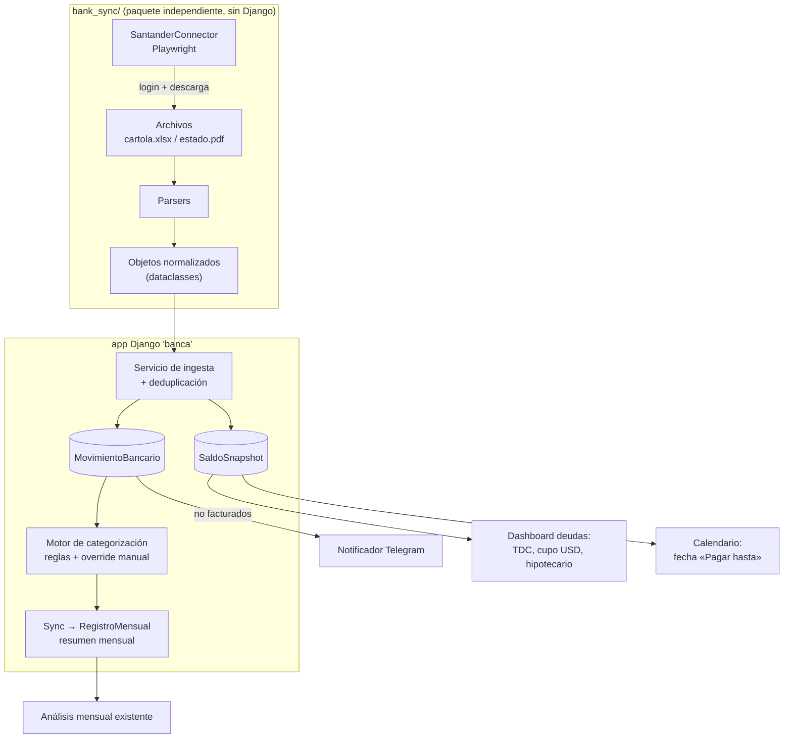
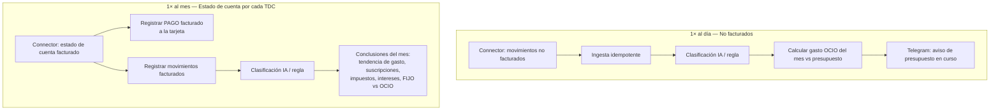
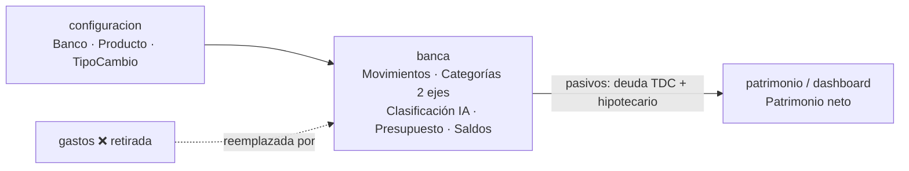
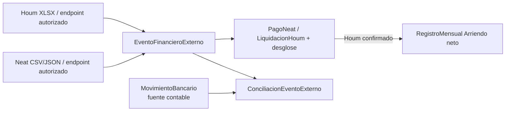
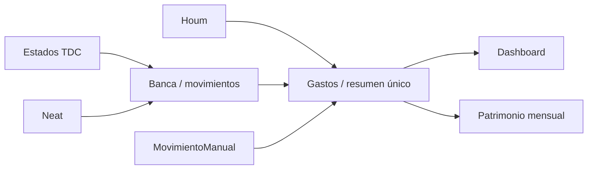

# Arquitectura de Integración Bancaria (Santander Chile → escalable a otros bancos)

> Diseño para automatizar la descarga de deudas y movimientos desde la banca en línea
> y alimentar el proyecto Django de finanzas personales. Estrategia elegida: **web scraping
> con navegador automatizado** (sin MFA, ya que la verificación reforzada solo aplica a
> transferencias/pagos, no a la lectura de datos).

---

## 1. Principios de diseño

1. **El scraper NO conoce Django.** La extracción vive en un paquete Python independiente
   (`bank_sync/`) que devuelve objetos normalizados (dataclasses). Esto lo hace testeable
   sin levantar Django y reutilizable desde un script, Celery o la consola.
2. **Una interfaz común por banco.** Cada banco implementa el mismo contrato
   (`BankConnector`). Santander primero; el resto solo implementa esa interfaz.
3. **Descargar archivos oficiales, no raspar HTML.** La cartola baja como Excel/CSV y el
   estado de cuenta como PDF. Parsear esos archivos es mucho más estable que depender del
   DOM, que cambia seguido.
4. **Idempotencia.** Re-sincronizar el mismo período no duplica datos ni pisa tu
   reclasificación manual.
5. **Capa transaccional nueva, sin romper lo existente.** Hoy el modelo es agregado mensual
   (`RegistroMensual`). Agregamos el detalle transacción a transacción y un paso de
   *sincronización* que lo resume hacia `RegistroMensual`.

---

## 2. Vista general (flujo de datos)



Dos cadencias distintas según tu requerimiento:

- **Rápida y frecuente** (diaria): movimientos *no facturados* del mes en curso → alertas Telegram.
- **Mensual**: *estado de cuenta facturado* → categorización, reclasificación y análisis.

---

## 3. Estructura de carpetas propuesta

```
personal_finance_ia/
├── bank_sync/                      # Paquete independiente (NO Django)
│   ├── __init__.py
│   ├── models.py                   # dataclasses normalizadas
│   ├── exceptions.py               # LoginError, ParseError, etc.
│   ├── registry.py                 # fábrica: nombre_banco -> Connector
│   ├── connectors/
│   │   ├── base.py                 # BankConnector (ABC = contrato común)
│   │   └── santander.py            # implementación Playwright
│   ├── parsers/
│   │   ├── santander_cartola.py    # Excel/CSV -> MovimientoNormalizado
│   │   └── santander_estado.py     # PDF -> EstadoCuenta + MovimientoNormalizado
│   └── session/
│       └── storage.py              # persistir cookies/sesión (evita re-login)
│
├── banca/                          # App Django nueva (puente con el ORM)
│   ├── models.py                   # CredencialBanco, MovimientoBancario, SaldoSnapshot, ReglaCategorizacion, SyncLog
│   ├── services/
│   │   ├── ingesta.py              # normalizado -> ORM (idempotente)
│   │   ├── categorizacion.py       # aplica reglas + respeta override manual
│   │   ├── sync_registro.py        # agrega -> gastos.RegistroMensual
│   │   └── notificador.py          # Telegram
│   ├── tasks.py                    # tareas Celery (ya tienes celery+redis)
│   └── management/commands/
│       ├── sync_banco.py           # `python manage.py sync_banco santander --modo no_facturado`
│       └── sync_banco.py           # `... --modo estado_cuenta --periodo 2026-05`
│
└── docs/ARQUITECTURA_INTEGRACION_BANCARIA.md   # este documento
```

---

## 4. El contrato común: `BankConnector`

Toda integración futura implementa esta interfaz. Es lo que hace el sistema "multi-banco".

```python
# bank_sync/connectors/base.py
from abc import ABC, abstractmethod
from datetime import date
from bank_sync.models import (
    DeudaResumen, MovimientoNormalizado, EstadoCuenta,
)

class BankConnector(ABC):
    nombre: str  # "santander", "bancochile", ...

    @abstractmethod
    def login(self, rut: str, clave: str) -> None: ...

    @abstractmethod
    def get_deudas(self) -> DeudaResumen:
        """Saldos actuales: cada TDC (con cupo USD y TC del banco) + hipotecario."""

    @abstractmethod
    def get_movimientos_no_facturados(self) -> list[MovimientoNormalizado]:
        """Compras del mes en curso aún no facturadas (para alertas)."""

    @abstractmethod
    def get_estado_cuenta(self, periodo: date) -> EstadoCuenta:
        """Estado de cuenta facturado de un período (movimientos + totales)."""

    @abstractmethod
    def logout(self) -> None: ...
```

### Objetos normalizados (independientes del banco)

```python
# bank_sync/models.py
@dataclass
class MovimientoNormalizado:
    fecha: date
    descripcion: str            # glosa/comercio tal como viene
    monto: Decimal              # en la moneda original
    moneda: str                 # "CLP" | "USD"
    tarjeta_id: str | None      # identificador de la tarjeta física (últimos 4)
    cuotas: tuple[int, int] | None   # (actual, total) si es en cuotas
    estado: str                 # "NO_FACTURADO" | "FACTURADO"
    # huella de identidad para deduplicar (ver §6)
    hash_externo: str

@dataclass
class SaldoTarjeta:
    tarjeta_id: str             # últimos 4 dígitos / alias
    nombre: str                 # "Visa Signature", etc.
    deuda_facturada_clp: Decimal
    deuda_no_facturada_clp: Decimal
    fecha_vencimiento: date | None
    cupo_total_clp: Decimal
    cupo_utilizado_clp: Decimal | None
    cupo_disponible_clp: Decimal
    cupo_avance_disponible_clp: Decimal | None
    # --- dólares ---
    tiene_cupo_usd: bool
    cupo_usd: Decimal | None
    cupo_usd_disponible: Decimal | None
    deuda_usd: Decimal | None
    tipo_cambio_banco: Decimal | None   # ¡el precio al que el banco TE vende el dólar!

@dataclass
class SaldoHipotecario:
    saldo_insoluto: Decimal     # lo que falta por pagar
    proxima_cuota_clp: Decimal
    proxima_cuota_uf: Decimal | None
    fecha_proximo_pago: date
    tasa: Decimal | None

@dataclass
class DeudaResumen:
    tarjetas: list[SaldoTarjeta]
    hipotecario: SaldoHipotecario | None

@dataclass
class EstadoCuenta:
    periodo: date
    tarjeta_id: str
    movimientos: list[MovimientoNormalizado]
    total_facturado_clp: Decimal
    total_facturado_usd: Decimal | None
    tipo_cambio_facturacion: Decimal | None  # TC usado en ESTA factura
```

> **Dato clave que pediste:** el dólar que el banco te vende tiene un precio propio,
> distinto del de mercado. Por eso `tipo_cambio_banco` (en el saldo) y
> `tipo_cambio_facturacion` (en el estado de cuenta) son campos separados y **no** se
> calculan con tu tabla `TipoCambio` (mindicador.cl = mercado). Guardamos ambos para poder
> medir cuánto te cobra el banco por sobre el mercado.

---

## 5. Modelos Django nuevos (app `banca`)

Se conectan con lo que ya tienes (`configuracion.Banco`, `configuracion.Producto`,
`configuracion.TipoCambio`, `gastos.CategoriaIngreso`/`RegistroMensual`).

```python
# banca/models.py (esquema; los detalles finales se afinan al implementar)

class CredencialBanco(models.Model):
    """Credenciales cifradas. El RUT/clave NUNCA en texto plano ni en git."""
    user        = models.ForeignKey('auth.User', on_delete=models.CASCADE)
    banco       = models.ForeignKey('configuracion.Banco', on_delete=models.CASCADE)
    rut         = models.CharField(max_length=20)
    clave_cifrada = models.BinaryField()          # Fernet (clave desde .env)
    activo      = models.BooleanField(default=True)

class MovimientoBancario(models.Model):
    """Transacción individual (la capa que hoy NO existe)."""
    user        = models.ForeignKey('auth.User', on_delete=models.CASCADE)
    producto    = models.ForeignKey('configuracion.Producto', on_delete=models.PROTECT)
    fecha       = models.DateField(db_index=True)
    descripcion = models.CharField(max_length=255)
    monto       = models.DecimalField(max_digits=15, decimal_places=2)
    moneda      = models.CharField(max_length=3, default='CLP')
    monto_clp   = models.DecimalField(max_digits=15, decimal_places=2)  # convertido con TC del banco
    tipo_cambio_banco = models.DecimalField(max_digits=10, decimal_places=4, null=True)
    cuota_actual = models.IntegerField(null=True)
    cuota_total  = models.IntegerField(null=True)
    ESTADO = [('NO_FACTURADO', 'No facturado'), ('FACTURADO', 'Facturado')]
    estado      = models.CharField(max_length=15, choices=ESTADO, db_index=True)
    periodo_factura = models.DateField(null=True)   # a qué estado de cuenta pertenece
    categoria   = models.ForeignKey('gastos.CategoriaIngreso', null=True, on_delete=models.SET_NULL)
    categoria_es_manual = models.BooleanField(default=False)  # protege tu reclasificación
    hash_externo = models.CharField(max_length=64)  # idempotencia por usuario
    notificado_telegram = models.BooleanField(default=False)
    created_at  = models.DateTimeField(auto_now_add=True)

class SaldoSnapshot(models.Model):
    """Foto de la deuda en una fecha (TDC o hipotecario)."""
    user        = models.ForeignKey('auth.User', on_delete=models.CASCADE)
    producto    = models.ForeignKey('configuracion.Producto', on_delete=models.CASCADE)
    fecha       = models.DateField(db_index=True)
    deuda_facturada_clp    = models.DecimalField(max_digits=15, decimal_places=2, null=True)
    deuda_no_facturada_clp = models.DecimalField(max_digits=15, decimal_places=2, null=True)
    fecha_vencimiento      = models.DateField(null=True)  # «Pagar hasta» del estado
    cupo_total_clp         = models.DecimalField(max_digits=15, decimal_places=2, null=True)
    cupo_utilizado_clp     = models.DecimalField(max_digits=15, decimal_places=2, null=True)
    cupo_disponible_clp    = models.DecimalField(max_digits=15, decimal_places=2, null=True)
    cupo_avance_disponible_clp = models.DecimalField(max_digits=15, decimal_places=2, null=True)
    cupo_usd               = models.DecimalField(max_digits=12, decimal_places=2, null=True)
    deuda_usd              = models.DecimalField(max_digits=12, decimal_places=2, null=True)
    tipo_cambio_banco      = models.DecimalField(max_digits=10, decimal_places=4, null=True)
    # hipotecario
    saldo_insoluto = models.DecimalField(max_digits=15, decimal_places=2, null=True)
    proxima_cuota  = models.DecimalField(max_digits=15, decimal_places=2, null=True)
    class Meta:
        unique_together = ('user', 'producto', 'fecha')

class ReglaCategorizacion(models.Model):
    """Aprende comercio -> categoría. Se aplica solo si el usuario no fijó manual."""
    user      = models.ForeignKey('auth.User', on_delete=models.CASCADE)
    patron    = models.CharField(max_length=255)   # substring o regex sobre la glosa
    es_regex  = models.BooleanField(default=False)
    categoria = models.ForeignKey('gastos.CategoriaIngreso', on_delete=models.CASCADE)
    prioridad = models.IntegerField(default=0)

class SyncLog(models.Model):
    """Auditoría de cada corrida: qué se bajó, cuántos movimientos, errores."""
    user        = models.ForeignKey('auth.User', on_delete=models.CASCADE)
    banco       = models.ForeignKey('configuracion.Banco', on_delete=models.CASCADE)
    modo        = models.CharField(max_length=20)   # no_facturado | estado_cuenta | deudas
    iniciado    = models.DateTimeField(auto_now_add=True)
    exito       = models.BooleanField(default=False)
    nuevos      = models.IntegerField(default=0)
    mensaje     = models.TextField(blank=True)
```

### Mapeo de tus entidades del mundo real

- **Cada tarjeta física** = un `configuracion.Producto` con `tipo='TDC'`. Si tiene cupo en
  dólares, marcas `tiene_cupo_usd=True` (campo que ya existe). Así "más de una tarjeta, cada
  una con su cupo USD" calza sin inventar tablas nuevas.
- La fecha explícita **«Pagar hasta»** del estado se conserva en `SaldoSnapshot` y se
  proyecta como evento del mes en Calendario; no se inventa una fecha cuando el PDF no la
  informa.
- Un estado internacional conserva `monto` y cupos en USD. Si coincide usuario, producto y
  fecha con el estado nacional, completa `deuda_usd`, `cupo_usd` y
  `cupo_usd_disponible` en el mismo `SaldoSnapshot` sin reemplazar los campos CLP. Sin tipo
  de cambio informado por el banco, `monto_clp` permanece en cero y la interfaz presenta
  el valor original en USD en vez de fabricar una conversión.
- **Crédito hipotecario** = un `Producto` con `tipo='CREDITO_HIPOTECARIO'`; su deuda vive en
  `SaldoSnapshot` (saldo insoluto + próxima cuota).

---

## 6. Idempotencia y reclasificación (lo más delicado)

**Deduplicación.** Cada movimiento trae un `hash_externo` = `sha256(fecha + monto + glosa +
tarjeta_id + cuota)`. La ingesta hace *upsert* por ese hash: si ya existe, no se inserta de
nuevo. La restricción real es `user + hash_externo`, por lo que el mismo movimiento sintético
en dos cuentas no mezcla datos. Esto permite correr el sync N veces sin duplicar.

**Tu criterio manda.** Cuando reclasificas un movimiento a mano, se marca
`categoria_es_manual=True`. El motor de categorización automática **nunca** sobrescribe un
registro con esa marca. Las `ReglaCategorizacion` solo actúan sobre lo que no tocaste, y
opcionalmente "aprenden": cuando reclasificas un comercio, te ofrece crear/actualizar la
regla para ese comercio a futuro.

**Transición provisional → facturado.** Apple Pay crea una fila `PROVISIONAL`. Un PDF con
período explícito la reconcilia estrictamente por usuario, producto, monto/moneda exactos y
fecha cercana; el comercio solo desempata. Un calce seguro actualiza esa misma fila a
`FACTURADO`, preservando decisiones manuales y avisos. Lo no incluido o ambiguo deja de
contabilizarse con auditoría de cierre; un PDF sin período no cierra provisionales.

---

## 7. Sincronización hacia `RegistroMensual`

Tu app hoy razona en agregados mensuales por categoría. La capa transaccional es la fuente
de verdad; el servicio `sync_registro.py` agrupa los movimientos **facturados** por
(`categoria`, `year`, `mes`) y hace *upsert* en `gastos.RegistroMensual`.

Decisión de diseño a confirmar contigo: para no pisar tus entradas manuales, propongo
**marcar** los `RegistroMensual` generados desde banca (un flag o una nota) y que el sync
solo actualice esos. Lo manual y lo automático conviven sin chocar.

---

## 8. Seguridad y robustez del scraping

- **Credenciales:** cifradas con `cryptography.Fernet`; la llave sale de `.env`
  (`python-decouple`, que ya usas). Nunca en el repo ni en la base en texto plano.
- **Sesión persistente:** se guardan cookies/`storage_state` de Playwright para evitar
  re-login en cada corrida y reducir fricción con el banco.
- **Tolerancia a fallos:** reintentos con backoff, *timeout* configurable, y **captura de
  screenshot + HTML al fallar** para depurar cuando el sitio cambie.
- **Modo headless conmutable:** headful para depurar el login la primera vez, headless en
  producción.
- **Verificación de dispositivo:** aunque la lectura no pide MFA, Santander a veces pide
  validar un dispositivo nuevo. El diseño deja un *hook* para intervención manual puntual.
- **Legal/ToS:** es tu propia data y uso personal; aun así conviene un *rate limit* prudente
  (no martillar el sitio) y correr el sync pocas veces al día.

---

## 9. Escalado multi-banco

Agregar un banco = crear `bank_sync/connectors/<banco>.py` que implemente `BankConnector` y
sus parsers. El `registry.py` lo expone por nombre y **todo lo de Django (modelos, ingesta,
categorización, Telegram, sync) se reutiliza sin cambios**. La app `banca` nunca tiene
lógica específica de un banco: esa vive 100% dentro de cada connector.

---

## 10. Roadmap por fases

| Fase | Entregable | Resultado |
|------|------------|-----------|
| **0** | Esqueleto `bank_sync/` + `BankConnector` + dataclasses + app `banca` con modelos y migraciones | La estructura existe y migra |
| **1** | `SantanderConnector.login()` + descarga de cartola, contra el sitio real | Probar que entramos y bajamos archivos |
| **2** | Parsers de cartola y estado de cuenta → `MovimientoNormalizado` | Datos normalizados confiables |
| **3** | Ingesta idempotente + `get_deudas()` → `SaldoSnapshot` (TDC con USD + hipotecario) | Dashboard de deudas |
| **4** | Categorización + reglas + reclasificación manual + sync a `RegistroMensual` | Análisis mensual alimentado solo |
| **5** | Notificador Telegram de no facturados + tareas Celery programadas | Alertas automáticas |
| **6** | Segundo banco (valida que la abstracción aguanta) | Multi-banco real |

---

## 11. Decisiones abiertas (a confirmar antes de codear)

1. **¿Escribir en `RegistroMensual` o mantener banca como módulo separado de solo lectura?**
   Recomiendo escribir, pero con la marca de §7.
2. **¿Una tarjeta física = un `Producto`, o agregamos un sub-modelo `Tarjeta`?** Recomiendo
   reusar `Producto` (ya soporta `tiene_cupo_usd`); solo si una tarjeta tiene varios titulares
   o numeraciones conviene el sub-modelo.
3. **Almacenamiento de credenciales:** Fernet en `.env` (simple) vs. llavero del SO (más
   seguro, menos portable). Recomiendo Fernet para empezar.
4. **Cadencia de sync:** diaria para no facturados; mensual (tras la fecha de facturación)
   para estado de cuenta. Ajustable por `Producto.dia_cobro` (campo que ya tienes).

---

## 12. Hallazgos reales del sitio (sesión del 09-06-2026)

Exploramos santander.cl en vivo con la sesión ya autenticada (login sin MFA, confirmado).
El sitio privado es un **SPA Angular** en `mibanco.santander.cl/UI.Web.HB/Private_new/`, pero
**los datos NO salen del HTML**: vienen de un *API gateway JSON* en
**`https://api-dsk.santander.cl/perdsk/`** vía `POST`. Esto cambia el método de extracción
para mejor (ver §13).

### Productos detectados en la cuenta

- **2 tarjetas de crédito físicas/principales:**
  - `WORLDMEMBER VISA` ****6691 — cupo pesos $5.000.000 (disp. $1.912.943), **cupo USD 0**.
  - `W. LIMITED VISA` ****6618 — cupo pesos $998.362 disp., **cupo USD 11.700** ← confirma tu
    requisito de cupo en dólares por tarjeta.
  - Además adicionales: digital ****1148 y pulsera ****5735.
- **1 crédito hipotecario** (sección *Créditos → Mis Créditos*).

### Mapeo pantalla → endpoint de API

| Necesidad tuya | Pantalla (ruta SPA) | Endpoint `api-dsk.santander.cl/perdsk/` | Método |
|----------------|---------------------|------------------------------------------|--------|
| Cupos y saldo (pesos + USD) por tarjeta | `Saldos_TC/main/detail` (MI TARJETA) | consolidado al login (a fijar: `…/consultaSaldo` / `productos`) | POST |
| **Movimientos NO facturados** (mes en curso) | `Saldos_TC/main/bill` (MOVIMIENTOS POR FACTURAR) | `tarjetasDeCredito/consultaUltimosMovimientos` | POST |
| **Estado de cuenta facturado** (por período) | `Saldos_TC/main/billed` (MOVIMIENTOS FACTURADOS) | `tarjetasDeCredito/estadoDeCuenta` | POST |
| **Deuda crédito / hipotecario** | `creditos/main/list-creditos` (MIS CRÉDITOS) | `serviciosCliente/creditoDeConsumo/deudaPendientePrestamo` | POST |
| Datos del cliente / campañas | varias | `datosCliente/consultaCampana` | POST |

Observaciones útiles para el connector:

- Cada vista de movimientos tiene un **toggle Pesos / Dólares** → el endpoint recibe la
  divisa como parámetro. Los movimientos en USD son una llamada aparte (clave para tu cupo
  dólar y el tipo de cambio del banco).
- El **estado de cuenta** trae un selector de *Fecha facturación* (período) y devuelve:
  monto total facturado, fecha de pago, pago mínimo, desglose (período anterior, pagos/abonos,
  utilizado titular/adicionales, cargos/comisiones) y el detalle de movimientos. Además hay un
  PDF "Ver estado de cuenta" como respaldo.
- Los **saldos/cupos se cachean** tras el login (no se re-piden al recargar una sub-ruta), así
  que el connector debe leerlos en el flujo de login o forzar la vista que los dispara.
- Campos por movimiento observados: `fecha`, `tipo` (ícono/categoría del banco), `detalle`
  (glosa/comercio, p.ej. `APPLE.COM/BILL`, `www.aliexpress.com`, `MERPAGO*...`), `monto`
  (cargo/abono con signo). Mapea directo a `MovimientoNormalizado`.

### Autenticación

Las llamadas van a `api-dsk.santander.cl` (gateway separado del front). La sesión se sostiene
con cookies/token emitidos en el login. Falta confirmar en implementación si el `POST` exige
un header `Authorization: Bearer …` firmado o basta la cookie de sesión — eso decide entre
"replay directo" e "interceptar respuestas" (ver §13).

---

## 13. Método de extracción definitivo (actualiza §3 de estrategia)

Dado que el sitio expone **JSON estructurado**, el método elegido es:

> **Playwright para autenticar + interceptar las respuestas JSON de `api-dsk.santander.cl`.**

Flujo del `SantanderConnector`:

1. Playwright hace login (RUT + clave) una vez; se persiste `storage_state` (cookies/token).
2. El connector navega las rutas SPA conocidas (`/bill`, `/billed`, `/list-creditos`, y la de
   saldos) seleccionando tarjeta y divisa.
3. Se **interceptan las respuestas** de los endpoints `perdsk/...` (Playwright
   `page.on("response")`) y se toma el JSON directamente — sin parsear HTML ni Excel.
4. Cada JSON se mapea a las dataclasses normalizadas (`MovimientoNormalizado`,
   `SaldoTarjeta`, `SaldoHipotecario`).

Por qué interceptar en vez de "replay directo" de la API:

- **No hay que reversear la firma de auth** ni replicar headers frágiles: la página ya hace la
  llamada autenticada; nosotros solo leemos la respuesta.
- **Robusto a cambios de DOM** (no dependemos de selectores visuales).
- Si más adelante confirmamos que basta la cookie, podemos pasar a *replay directo* (más
  rápido, sin render) reusando `storage_state`. Queda como optimización opcional.

El **PDF del estado de cuenta** se mantiene como *fallback* del parser por si un período no
viene completo en el JSON.

### Impacto en el roadmap

- Fase 1 pasa de "descargar cartola" a **"login + interceptar `consultaUltimosMovimientos`"**.
- Fase 2 pasa de "parsear Excel/PDF" a **"mapear JSON → dataclasses"** (más simple y estable).
- El resto del roadmap (ingesta, categorización, sync, Telegram, multi-banco) no cambia.

---

## 14. Reingeniería del proyecto (decisiones 09-06-2026)

> Esta sección **supersede** el enfoque agregado-mensual del proyecto actual y reemplaza la
> categorización por reglas de §6 por una **clasificación con IA**. El proyecto deja de ser
> "cargar a mano un agregado por categoría cada mes" (herencia del Excel) y pasa a ser
> "el banco entrega cada transacción; todo lo demás se deriva".

### 14.1 Principio: el movimiento es la única fuente de verdad

`gastos.RegistroMensual` y la carga manual **se jubilan**. Ya no se ingresa nada a mano de
forma rutinaria. Cualquier total mensual, presupuesto o conclusión se **calcula al vuelo**
desde `MovimientoBancario` (con vistas/consultas agregadas, no con filas guardadas). Decisión
tomada: *"Jubilarlo, movimientos como verdad"*.

Migración: se conserva el histórico de `RegistroMensual` como solo-lectura para no perder lo
ya cargado, pero no se escribe más en él. Una vista de "resumen mensual" se reconstruye
agregando movimientos.

### 14.2 Categorías de DOS EJES

Cada movimiento se describe con dos dimensiones independientes. Decisión tomada:
*"Dos ejes (esencialidad + temática)"*.

- **Eje 1 — Esencialidad** (`FIJO` | `OCIO`): para el **aviso de presupuesto**.
  - `FIJO` = lo que sí o sí debes pagar: hipotecario, arriendo, servicios, seguros.
  - `OCIO` = todo lo demás → es el cupo que el sistema vigila para advertirte si te estás
    pasando ("vas gastando X en Ocio este mes").
- **Eje 2 — Categoría temática**: para las **conclusiones y tendencias** (suscripción,
  impuesto, interés, supermercado, restaurant, transporte, salud, etc.).

La esencialidad **se deduce** de la categoría temática (cada categoría trae una esencialidad
por defecto), con override manual por movimiento cuando haga falta. No es doble trabajo: la
IA clasifica la temática y el eje FIJO/OCIO sale solo.

```python
# banca/models.py  (reemplaza la idea de ReglaCategorizacion de §6)

class CategoriaTematica(models.Model):
    """Categoría granular para análisis (suscripción, impuesto, interés, etc.)."""
    user        = models.ForeignKey('auth.User', on_delete=models.CASCADE)
    nombre      = models.CharField(max_length=100)
    ESENCIALIDAD = [('FIJO', 'Fijo'), ('OCIO', 'Ocio')]
    esencialidad_defecto = models.CharField(max_length=4, choices=ESENCIALIDAD, default='OCIO')
    activa      = models.BooleanField(default=True)

# En MovimientoBancario se agregan / ajustan:
#   categoria       -> FK a CategoriaTematica (null hasta clasificar)
#   esencialidad    -> 'FIJO' | 'OCIO'  (deducida de la categoría, overridable)
#   FUENTE = [('IA','IA'), ('REGLA','Regla aprendida'), ('MANUAL','Manual')]
#   fuente_clasificacion = CharField(choices=FUENTE)
#   confianza_ia    -> DecimalField(null=True)   # 0–1, para revisar dudosas
#   clasificado_at  -> DateTimeField(null=True)
```

### 14.3 Clasificación con IA (clasifica una vez, reutiliza siempre)

Pipeline de `banca/services/clasificacion_ia.py`:

1. Tomar solo los movimientos **sin clasificar** (`categoria IS NULL`).
2. Para cada glosa, primero buscar en `MapeoComercio` (comercio→categoría ya aprendido). Si
   hay match, se asigna **sin llamar a la IA**.
3. Lo que queda (comercios nuevos) se manda **en lote** a la IA vía API, que devuelve
   `categoria` + `confianza`. Se guarda con `fuente_clasificacion='IA'`.
4. Cada resultado nuevo **crea/actualiza un `MapeoComercio`** para que la próxima vez ese
   comercio se resuelva por regla (eje de ahorro de costos: `APPLE.COM/BILL`,
   `www.aliexpress.com`, etc. se clasifican una sola vez en su vida).
5. Si tú reclasificas a mano → `fuente_clasificacion='MANUAL'`, `categoria_es_manual=True`.
   **La IA y las reglas nunca pisan lo manual.**

```python
class MapeoComercio(models.Model):
    """comercio (glosa normalizada) -> categoría aprendida. Evita re-llamar a la IA."""
    user      = models.ForeignKey('auth.User', on_delete=models.CASCADE)
    patron    = models.CharField(max_length=255, db_index=True)   # glosa normalizada
    categoria = models.ForeignKey('banca.CategoriaTematica', on_delete=models.CASCADE)
    origen    = models.CharField(max_length=10, default='IA')     # IA | MANUAL
    hits      = models.IntegerField(default=0)                     # cuántas veces se usó
```

> Proveedor de IA: **OpenRouter** (API Key del usuario en `.env`). El servicio se diseña con
> una interfaz `ClasificadorIA` para poder cambiar de modelo/proveedor sin tocar el resto. Para
> la mayoría de los movimientos recurrentes ni siquiera se invoca (resuelven por
> `MapeoComercio`), así que el costo es bajo.

### 14.4 Flujo por banco (como lo describiste)

Mismo patrón para Banco 1, Banco 2, … cada uno detrás de su `BankConnector`:



- **Diario / no facturados** → solo advertir. Es el control de presupuesto del mes en curso;
  el eje `OCIO` es lo que se vigila.
- **Mensual / estado de cuenta** → registrar el **pago facturado** que debes hacer a la TDC,
  registrar el detalle facturado, y de ahí salen las **conclusiones** (tendencias,
  suscripciones recurrentes, impuestos, intereses, reparto FIJO vs OCIO).

### 14.5 Capa de conclusiones

Un módulo `banca/services/analisis.py` (o vistas/consultas) que, sobre los movimientos ya
clasificados, produce: gasto FIJO vs OCIO del mes, evolución mensual por categoría temática,
detección de **suscripciones** (cargos recurrentes mismo comercio/monto), total de
**impuestos** e **intereses**, y el **monto a pagar** por cada tarjeta. Todo derivado, nada
cargado a mano.

### 14.6 Qué cambia respecto a las secciones previas

- §5: `MovimientoBancario` gana `categoria` (temática), `esencialidad`, `fuente_clasificacion`,
  `confianza_ia`. Se agregan `CategoriaTematica` y `MapeoComercio`.
- §6: la categorización por `ReglaCategorizacion` se reemplaza por **IA + `MapeoComercio`**
  (la idea de "no pisar lo manual" se mantiene igual).
- §7: el sync hacia `RegistroMensual` **se elimina**; los agregados se calculan al vuelo.

---

## 15. Ciclo de vida del movimiento, presupuesto y caja (decisiones 09-06-2026)

> Resuelve la duda central: **no se duplican** los no facturados con los facturados, y se
> corrige el vicio heredado del Excel de confundir *gasto* con *pago*.

### 15.1 Gasto ≠ Pago (la causa raíz del doble conteo)

Una compra con TDC tiene **tres momentos**, no uno:

1. **Compra (devengo):** pasas la tarjeta. *Aquí ocurre el gasto.* Se cuenta **una sola vez**,
   con fecha de compra.
2. **Facturación:** al cierre, esa compra entra al estado de cuenta. *Mismo gasto*, ahora
   cobrable.
3. **Pago de la TDC:** el 1° pagas la tarjeta desde la cuenta corriente. **Esto NO es un
   gasto**: es una *transferencia que salda* compras ya contadas. Se marca
   `contabilizar=False` para que **no** sume al egreso. (El campo `contabilizar` que ya existía
   en el proyecto era exactamente este instinto, correcto.)

Ejemplo del vicio Excel: compras el móvil por TDC el 15-jun (gasto de junio). Se factura el
25-jul. Lo pagas el 01-ago. El error era registrarlo "cuando lo pago" (agosto); en realidad se
gastó en junio. El sistema lo cuenta en junio automáticamente y muestra la salida de caja de
agosto por separado.

### 15.2 Estados del movimiento y no-duplicación

Un movimiento de TDC es **una sola fila contable** con ciclo de vida:

```
PROVISIONAL (Apple Pay) ──(PDF/cierre)──► FACTURADO ──(pago derivado)──► PAGADO
                         └─(no aparece)──► DESCARTADO_CIERRE
```

La transición se reconcilia con el producto/tarjeta, monto y moneda exactos y una ventana
acotada de fecha. La glosa decide solo cuando hay más de un candidato claro; si continúa
ambiguo, nunca se adivina. La huella bancaria final reemplaza la provisional y mantiene el
`ApplePayEvent`, las decisiones manuales y el registro de notificación.

**Paso de confirmación de fin de mes:** cuando llega el estado de cuenta, el sistema muestra
los movimientos facturados con su categoría detectada por IA para que **confirmes/ajustes** y
"cierres" el mes. Ese mismo paso es el punto de reconciliación y donde se fija el **pago de la
tarjeta**.

### 15.3 Dos vistas derivadas de los mismos datos

| Vista | Fecha que usa | Para qué sirve |
|-------|---------------|----------------|
| **Devengo** ("lo que pasó / mi gasto real") | fecha de **compra** | Presupuesto y comportamiento del mes en curso (¿me paso en Ocio?). **Base elegida.** |
| **Caja** ("lo que tengo que pagar el 1°") | fecha de **pago** | Lista de "siéntate a pagar": total facturado por TDC + pagos no-TDC (arriendo, mantención, efectivo). |

Ambas se calculan de la misma tabla de movimientos; ninguna duplica a la otra.

### 15.4 Presupuesto por ingreso promediado

Decisión: el gasto se mide en **devengo**, y el techo disponible se estima promediando
ingresos.

```
Disponible_Ocio  ≈  promedio_ingresos(ventana)  −  comprometido
   comprometido  =  FIJO (hipotecario, arriendo, servicios, seguros)
                  +  cuotas activas del mes
```

- `ventana` configurable (ej. últimos 3–6 meses) para **suavizar ingresos variables**.
- El **Ocio devengado** del mes se compara contra `Disponible_Ocio`; al acercarse al límite,
  **aviso por Telegram**.
- `FIJO` es independiente del medio de pago: arriendo/móvil pagados por TDC vía **NeatPagos**
  siguen siendo `FIJO` aunque su cobro sea por tarjeta (de ahí los dos ejes de §14.2).

### 15.5 Cuotas

Realidad observada: una compra en cuotas **normalmente no aparece** en *no facturados* durante
el mes; recién se ve en el **estado de cuenta** como "cuota X/Y". Por eso:

- Se tratan **por cuota mensual**: cada cuota cuenta como gasto en el mes que se factura y es
  **comprometido** (reduce el `Disponible_Ocio` de ese mes). Castiga el presupuesto del mes
  correspondiente, como debe ser.
- **Sin doble conteo:** como la compra original en cuotas no se capturó en devengo, contar la
  cuota en su mes no duplica nada.
- **Regla de borde:** si alguna vez una compra en cuotas *sí* aparece en no facturado, se
  reconcilia con sus cuotas (se vincula a la compra padre) y **no** se suma dos veces.
- La esencialidad de la cuota sigue a la categoría del consumo original, pero por estar ya
  **comprometida** se descuenta del disponible como un costo fijo del mes.

---

## 16. Organización de apps y convivencia (decisiones 09-06-2026)

> El proyecto actual es un **prototipo**, así que no hay que preservar nada con celo: `banca`
> nace como el motor definitivo y la app `gastos` **se retira**.

### 16.1 Mapa de apps existentes (estado al 09-06-2026)

- **core** — infra: perfil, período activo, auditoría.
- **configuracion** — referencia: `Banco`, `Producto` (TDC, hipotecario, cuenta; `tiene_cupo_usd`,
  `dia_cobro`), `TipoCambio` (UF/USD), config general.
- **gastos** — `CategoriaIngreso`, `RegistroMensual` (agregado manual), `GastoProgramado`.
- **patrimonio** — `Activo` (efectivo, cripto, fondos, acciones, propiedades, préstamos dados),
  `HistorialActivo`. Patrimonio neto.
- **departamentos** — propiedades en arriendo (UF, avance hipoteca), enlazadas a `Activo`.
- **inversiones** — vacía (fusionada en patrimonio; solo historial de migraciones).
- **prestamos** — `Prestamo` (personales / terceros).

### 16.2 Decisión: `banca` reemplaza a `gastos`

Por ser prototipo, **se descarta `gastos`** (RegistroMensual, CategoriaIngreso y la carga
manual). `banca` pasa a ser el **motor de egresos transaccional** (movimientos, dos ejes,
clasificación IA, presupuesto). Lo único de `gastos` que vale la pena rescatar —la **agenda de
gastos recurrentes** (`GastoProgramado`)— se reimplementa, si se necesita, dentro del modelo de
*comprometido* de `banca` (§15.4), no como app aparte.

### 16.3 Dependencias entre apps



- `banca` **depende de** `configuracion` (reúsa Banco/Producto/TipoCambio); no la duplica.
- `banca` es **fuente de pasivos**: los `SaldoSnapshot` de TDC e hipotecario alimentan
  automáticamente los pasivos del **patrimonio neto / dashboard**. Decisión tomada:
  *"Sí, banca es fuente de pasivos"*. Menos carga manual, dashboard siempre al día.
- `gastos` queda **fuera**.

### 16.4 Integración con patrimonio (pasivos automáticos)

El dashboard hoy calcula patrimonio neto = activos − pasivos. Con esto, los pasivos de TDC e
hipotecario dejan de ser manuales: se leen del último `SaldoSnapshot` por `Producto`. El
servicio de patrimonio expone un *hook* (señal o consulta) que toma esos saldos al cierre de
cada sync. Así la foto de deuda del dashboard refleja el banco real sin que tú la actualices.

---

## 17. Naturaleza del movimiento y "bicicleta financiera" (decisiones 09-06-2026)

> Problema: hay movimientos que **no son ni ingreso ni gasto real** (mueven plata que da una
> vuelta y vuelve). Si se cuentan, **ensucian** el promedio de ingresos (y por ende el
> presupuesto) y el patrimonio. Caso principal: la **bicicleta financiera** vía NeatPagos.

### 17.1 Tercer atributo del movimiento: `naturaleza`

Además de los dos ejes de categoría (§14.2), cada movimiento lleva una **naturaleza**:

- **`OPERACIONAL`** — ingreso o gasto de verdad. **Solo estos** entran al promedio de ingresos,
  al gasto y al presupuesto Ocio.
- **`TRANSFERENCIA`** (no operacional) — plata que neta cero: bicicleta, pago de TDC, traspasos
  entre cuentas propias, avances que se devuelven. Se **registran** (para trazabilidad) pero se
  **excluyen** de ingresos, gasto, Ocio y del cálculo de patrimonio como ingreso.

```python
# En MovimientoBancario:
#   NATURALEZA = [('OPERACIONAL','Operacional'), ('TRANSFERENCIA','Transferencia / no operacional')]
#   naturaleza = CharField(choices=NATURALEZA, default='OPERACIONAL')
#   prestamo   = FK('prestamos.Prestamo', null=True)   # vínculo de las patas de bicicleta
```

### 17.2 Anatomía de la bicicleta financiera

Las 4 patas, todas `TRANSFERENCIA`, vinculadas a un `prestamos.Prestamo`:

1. **Cargo NeatPagos a la TDC** = principal + comisión. Aumenta deuda TDC y crea la
   **cuenta por cobrar** (principal) contra el conocido.
2. **Envío al conocido** — préstamo dado (la cuenta por cobrar ya queda registrada).
3. **Retorno del conocido** — devuelve principal (+ comisión). Salda la cuenta por cobrar.
4. **Pago de la TDC** — con lo retornado; saldar tarjeta, no es gasto (ya en §15.1).

El **principal neta cero** en patrimonio (efectivo ⇄ por cobrar). La **comisión** la frenteas
en (1) pero te la reintegra el conocido en (3) → **también neta cero**. El **único costo real**
son los **intereses** de financiamiento TDC si revuelves el avance: eso es `OPERACIONAL`, gasto
financiero, y alimenta las conclusiones de "intereses".

> Ejemplo (Juanita, préstamo $5.000.000): NeatPagos carga a la TDC **$5.060.000** (principal +
> comisión $60.000). Juanita recibe $5.000.000 y devuelve **$5.060.000** — en **una** transfer
> o **partida** ($5.000.000 y luego $60.000). Todo `TRANSFERENCIA`, vinculado al préstamo de
> Juanita. Neto en patrimonio e ingresos: **cero**.

### 17.3 Reglas de calce (reconciliación con `prestamos`)

Decisión: **vincular a un préstamo registrado + confirmación**. El usuario registra la
bicicleta en `prestamos.Prestamo` (Juanita, $5.000.000); `banca` calza los movimientos así:

- **Cargo → préstamo:** un cargo TDC vía NeatPagos cuyo monto sea **≥ `Prestamo.monto_total`**,
  con la diferencia (comisión) dentro de una **tolerancia** configurable (p.ej. ≤ 2–3% o un tope
  de fee NeatPagos). Se marca `naturaleza=TRANSFERENCIA`, `prestamo=<ese>`.
- **Retornos → préstamo:** abonos de la **misma contraparte** (RUT/alias) que **sumen** ≈ el
  monto cargado; admite **retornos partidos** en varias transferencias. Cada uno
  `TRANSFERENCIA`, `prestamo=<ese>`.
- **Comisión:** se rastrea como adelanto recuperable; al llegar su reintegro, queda en cero. Si
  **no** se reintegra, recién ahí se reclasifica como costo real.
- **Red de seguridad:** cualquier **abono que no calce** limpio a un préstamo queda **"por
  revisar"** en el cierre de mes y **NUNCA** se cuenta como ingreso por defecto. Así un ingreso
  real y un retorno de bicicleta no se confunden silenciosamente.

### 17.4 Efecto en cada vista

- **Promedio de ingresos / presupuesto:** ignora todo `TRANSFERENCIA` → queda limpio.
- **Patrimonio:** el principal solo cambia de forma (efectivo ⇄ `prestamos`/cuenta por cobrar);
  neto cero. La integración de §16.4 suma deuda TDC pero la contrapesa la cuenta por cobrar.
- **Conclusiones:** solo los **intereses** reales de financiamiento aparecen como costo.

---

## 18. Fuentes explicativas Houm y NeatPagos

Estas fuentes no implementan `BankConnector`: usan contratos read-only especializados y se
persisten fuera de `MovimientoBancario`. `EventoFinancieroExterno` conserva la evidencia;
`PagoNeat` y `LiquidacionHoum` guardan el detalle; `ConciliacionEventoExterno` asigna importes
al movimiento bancario real. Houm enlaza sus propiedades con `Departamento` y solo actualiza
el registro mensual cuando el neto está confirmado y no contradice un valor manual.



La cadencia vive en `CredencialBanco`, se evalúa por zona horaria y es compartida por botón,
Celery y comandos. El detalle operativo está en `docs/INTEGRACION_HOUM_NEAT.md`.

---

## 19. Centro financiero unificado (decisión vigente 08-09-2026)

Esta sección reemplaza las decisiones históricas de retirar por completo la app `gastos`
y de sincronizar fuentes hacia `RegistroMensual`.

- `gastos` permanece como capa de presentación y cálculo con perspectivas **caja** y
  **consumo**; `banca` conserva la ingesta, conciliación y operación.
- `CategoriaTematica` es la única taxonomía. `CategoriaIngreso` y `RegistroMensual` se
  eliminaron físicamente.
- El monto facturado vigente de una TDC, en su mes de vencimiento, es el egreso oficial.
  Los movimientos sólo forman su desglose y una diferencia firmada completa el cuadre.
- Houm suma una vez el depósito neto confirmado de una propiedad vinculada. Neat reemplaza
  el detalle genérico de un cargo conciliado, sin crear un segundo egreso.
- `MovimientoManual` cubre exclusivamente información aún no importada. Sus naturalezas
  distinguen operación, activo recuperable, inversión y transferencia interna.
- `Producto` pertenece obligatoriamente a un usuario; `Banco` continúa global. Los estados
  corregidos se versionan y sólo uno queda vigente por producto, moneda y mes de pago.
- `GastoProgramado` se conserva como previsión de calendario y nunca se suma como realizado.


